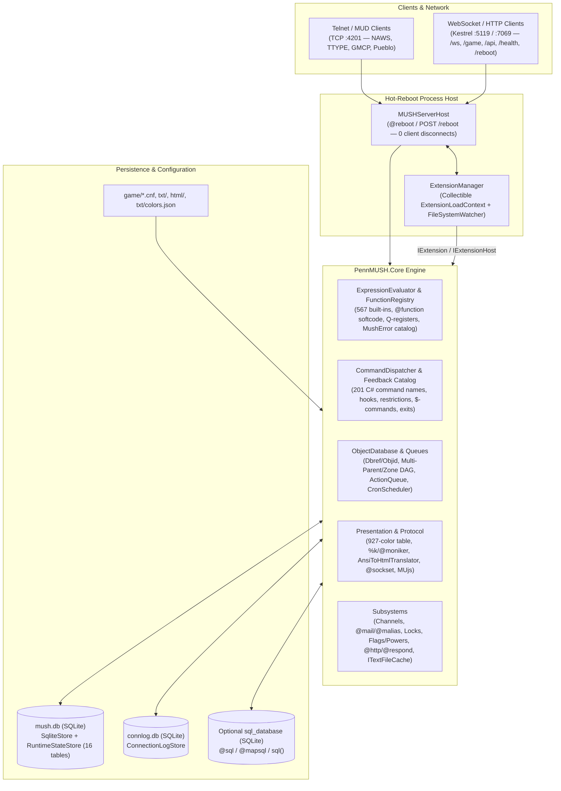

# PennMUSH .NET (`pennmush-dotnet`)

A modernized, clean-room implementation of the **PennMUSH** virtual world engine built on **.NET 10** (`net10.0`), preserving classic MUSHcode compatibility while adding ASP.NET Core WebSocket/HTTP transports, SQLite persistence, collectible-assembly hot-reloadable C# plugins, and zero-disconnect hot-reboots.

- **Runtime**: .NET 10 (`net10.0`) across 4 projects (`PennMUSH.Core`, `PennMUSH.Extensions`, `PennMUSH.Server`, `PennMUSH.Core.Tests`)
- **MUSHcode Functions**: **567** distinct built-in function registrations across 18 modules (**40** `noParse`, **29** `sideEffect`), plus **18** `function_alias` entries in `game/alias.cnf` (**578** total callable names under default config)
- **Player Commands**: **139** handler registrations covering **201** distinct built-in C# command names/aliases, plus **21** `command_alias` entries in `game/alias.cnf` (**204** total command names under default config) and pre-login commands (`connect`/`conn`/`co`, `create`/`cr`, `WHO`, `QUIT`)
- **Test Suite**: **480** tests across **97** test files

---

## Architecture Overview



---

## Key Capabilities

- **MUSHcode Engine & Safety**: Full bracket/brace/escape parser with `noParse` semantics, Q-registers (`%q0–%qz`, `%q<name>`), regex capture registers (`$0–$9`, `$<name>`), centralized `MushError` catalog (**91** templates), invocation/recursion/deadline runaway-loop protection, `@function` user-defined softcode functions, and `async()` / `parallel_map()` / `bgtask()` background tasks.
- **DAG World Model & Subsystems**: Directed acyclic graph multi-parent inheritance and multi-zone membership (breadth-first DAG traversal with cycle detection), **45** built-in flags, **31** built-in powers, **13** lock types, command hooks (`@hook`), warnings (`@warnings` / `@wcheck`), building quotas with atomic `RQUOTA` accounting, `@decompile`, channels (`@channel`/`@chat`/`addcom`), and threaded `@mail` + `@malias`.
- **Rich Presentation, ANSI & Web Delivery**: Full **927-entry** X11 / xterm-256 / RGB24 color table (`game/txt/colors.json`), `@moniker` ANSI sanitization and `%k`/`%K`, ANSI-aware `align()`/`wrap()`, Pueblo & `AnsiToHtmlTranslator`, `@sockset` session transforms (`OUTPUTPREFIX`, `OUTPUTSUFFIX`, `STRIPACCENTS`, `PROMPT_NEWLINES`, `NOQUOTA`, `COLORSTYLE`), and `wshtml()` / `wsjson()` WebSocket framing.
- **MUjs Protocol & Inbound HTTP**: Structured WebSocket/GMCP JSON envelope protocol (`client.hello`, `server.hello`, `terminal.input`/`terminal.output`, `editor.open`/`save`/`result`/`close`, `window.update`, `style.load`, `audio.play`, `ws.json`) backed by `@client` and `cedit()`/`cwindow()`/`cstyle()`/`caudio()`/`client_emit()`, plus softcode HTTP request routing via `http_handler` (`@http` / `@respond`).
- **SQLite Persistence & Zero-Disconnect Hot-Reboot**: Atomic persistence across `mush.db` (**16** tables covering objects, attributes, flags, powers, parents, zones, cron jobs, channels, mail, mail aliases, softcode functions, and sitelocks), `connlog.db` connection history (`connlog()`, `connrecord()`, `addrlog()`, `@sitelock/player`), and an optional separate SQLite SQL DB (`sql()`, `mapsql()`, `sqlescape()`, `@sql`, `@mapsql`). `MUSHServerHost` persists state and swaps the engine instance in-process without dropping active TCP or WebSocket sockets.
- **PennMUSH Flatfile Import (`DBF_LABELS` / `dbversion 6`)**: Import existing PennMUSH 1.8.x flatfile dumps (plain text or `.gz` compressed, including labeled flags/powers/locks and sparse dbref layouts) directly into SQLite via CLI flags.
- **Collectible C# Plugin SDK (`PennMUSH.Extensions`)**: Plugins implement `IExtension` against `IExtensionHost` (commands, functions, tick services, custom protocol handlers), load from memory streams without locking DLLs on disk, and hot-reload automatically via `FileSystemWatcher` or `@plugin` (`/list`, `/load`, `/unload`, `/reload`).

---

## Solution & Repository Layout

```text
pennmush-dotnet/
├── PennMUSH.slnx                  # .NET 10 solution file
├── PennMUSH.Core/                 # Platform-agnostic MUSH engine library
│   ├── Access/                    # SiteLock table & connection ACLs
│   ├── Attributes/                # Standard attribute table, prefix matching & writer
│   ├── Commands/                  # Dispatcher, command table/catalog, 70+ handlers, Feedback catalog
│   ├── Communication/             # Channels, @mail, @malias, emits & nospoof formatting
│   ├── Configuration/             # mush.cnf/alias.cnf/restrict.cnf parser & ConfigCatalog
│   ├── Database/                  # ObjectDatabase, SqliteStore, RuntimeStateStore, ConnectionLogStore, SqlDatabase
│   ├── Entities/                  # MUSHObject & parent/zone DAG traversal
│   ├── Flags/                     # FlagTable (45 flags, 31 powers) & permission checks
│   ├── Help/                      # HelpStore, ITextFileCache/TextFileCache, SuggestionVocabulary
│   ├── Http/                      # @http outbound fetch & @respond inbound HTTP channel
│   ├── Locks/                     # 13 lock types, AST parser & evaluator
│   ├── Logging/                   # Wizard logs & log management
│   ├── MUSHcode/                  # ExpressionEvaluator, FunctionRegistry, MushError, 18 Function modules
│   ├── Presentation/              # 927-color AnsiColorTable, AnsiToHtml/HtmlToAnsi, TelnetNegotiator
│   ├── Protocol/                  # MUjs ProtocolEnvelope/Payloads, EditorSessionManager, WebSocketMarkup
│   ├── Queue/                     # ActionQueue, semaphores & PID tracking
│   ├── Scheduling/                # CronScheduler & persistent @cron jobs
│   ├── Session/                   # ISessionDirectory, SessionInfo & connection access helpers
│   └── Types/                     # Dbref & ObjectType
├── PennMUSH.Extensions/           # Public plugin SDK (IExtension, IExtensionHost, ITickService, IProtocolHandler)
├── PennMUSH.Server/               # Executable host (Telnet :4201 + ASP.NET Core HTTP/WS)
│   ├── Commands/                  # Host-only commands (@plugin/@extension, @reboot)
│   ├── Engine/                    # MUSHServer, MUSHServerHost, ScreenStylesheet
│   ├── Extensions/                # ExtensionManager, collectible ExtensionLoadContext, ExtensionHostProxy
│   ├── Network/                   # TelnetListenerService
│   ├── Session/                   # ConnectionDirectory & MUSHConnection
│   └── Program.cs                 # Kestrel endpoints & host wiring
├── PennMUSH.Core.Tests/           # xUnit suite (469 tests across 95 test files)
├── game/                          # Default runtime data (mush.cnf, alias.cnf, restrict.cnf, txt/, html/)
├── plugins/                       # External plugin DLL drop-in directory
└── docs/
    ├── wiki/                      # Authoritative documentation mirrored to GitHub Wiki
    └── archive/                   # Historical PR #1–#54 porting & parity logs
```

---

## Quick Start

### Prerequisites

- [.NET 10 SDK](https://dotnet.microsoft.com/download/dotnet/10.0)
- Git

### Build & Run Tests

```bash
git clone https://github.com/naHrej/pennmush-dotnet.git
cd pennmush-dotnet
dotnet build PennMUSH.slnx
dotnet test PennMUSH.slnx
```

### Run the Server

```bash
dotnet run --project PennMUSH.Server
```

By default:
- **Telnet**: `0.0.0.0:4201` (configurable via `Telnet:Port` / `game/mush.cnf`)
- **HTTP & WebSockets** (`PennMUSH.Server/Properties/launchSettings.json`): `http://0.0.0.0:5119` (and `https://0.0.0.0:7069` under the `https` profile)
  - WebSocket MUjs / raw gateways: `/ws`, `/game` (plus `/api` companion socket)
  - Health & hot-reboot: `GET /health`, `POST /reboot`
  - Shared screen stylesheet: `GET /html/stylesheet.css`
  - All other unmatched HTTP routes fall back to the `http_handler` object if configured in `game/mush.cnf`.

First-boot world generation (`WorldBootstrapper`) initializes `#0` Room Zero, `#1` God (`One`, unpassworded on initial bootstrap — set a password promptly with `@password`), and `#2` Master Room, plus the default `Public` channel. At the login prompt:

```text
connect One
```

Or create a new player:

```text
create MyPlayer mysecretpassword
```

### Server CLI Options & Flatfile Import

`PennMUSH.Server` accepts optional CLI flags for custom paths, seeding `#1`'s password, and importing PennMUSH `DBF_LABELS` (`dbversion 6`) flatfiles (`.db` or `.gz`):

- `--db <path>` — Path to the SQLite database file (default: `game/mush.db`)
- `--config <path>` — Path to `mush.cnf`
- `--import-flatfile <path>` — Import a PennMUSH flatfile (plain or `.gz`) into the target SQLite database
- `--import-only` — Exit after completing the flatfile import without starting listeners
- `--seed-password <password>` — Set `#1` (`God`) password on startup or import

```bash
# Import a PennMUSH flatfile into a SQLite database and seed #1's password
dotnet run --project PennMUSH.Server -- --import-flatfile game/outdb.gz --db game/imported.db --seed-password secret --import-only

# Start the server using the imported database
dotnet run --project PennMUSH.Server -- --db game/imported.db
```

---

## Documentation Hub

Browse the live **[GitHub Wiki](https://github.com/naHrej/pennmush-dotnet/wiki)** (or read the source markdown directly under [`docs/wiki/`](docs/wiki/Home.md)):

| Guide / Reference | Summary | Wiki / Source |
|---|---|---|
| **Home** | Role-based entry hub and overview | [Home](docs/wiki/Home.md) |
| **Architecture & Concepts** | Dbrefs/Objids, Multi-Parent/Zone DAGs, command pipeline, queues, hot-reboot | [Architecture-and-Concepts](docs/wiki/Architecture-and-Concepts.md) |
| **MUSHcode Language Guide** | Evaluation order, `noParse`, `%`-substitutions, Q-registers, `MushError` | [MUSHcode-Language-Guide](docs/wiki/MUSHcode-Language-Guide.md) |
| **Flags, Powers, Attributes & Locks** | All 45 flags, 31 powers, standard attributes, 13 lock types | [Flags-Powers-Attributes-and-Locks](docs/wiki/Flags-Powers-Attributes-and-Locks.md) |
| **Colors, Markup & Presentation** | 927-color palette, `@moniker`/`%k`, ANSI-to-HTML, `@sockset`, `wshtml()`/`wsjson()` | [Colors-Markup-and-Presentation](docs/wiki/Colors-Markup-and-Presentation.md) |
| **Functions Index & API Reference** | Master A–Z index and 15 domain guides for all **567** built-in C# functions (**578** with `alias.cnf`) | [Functions-Index](docs/wiki/Functions-Index.md) |
| **Commands Index & Reference** | Master A–Z index and 8 domain guides for all **201** C# command names (**204** with `alias.cnf`) + pre-login commands | [Commands-Index](docs/wiki/Commands-Index.md) |
| **MUjs Protocol Reference** | WebSocket/GMCP JSON envelopes, editor & UI dock payloads | [MUjs-Protocol-Reference](docs/wiki/MUjs-Protocol-Reference.md) |
| **Server Configuration & Persistence** | `mush.cnf` options, SQLite schemas, `ITextFileCache`, HTTP & CI/CD | [Server-Configuration-and-Persistence](docs/wiki/Server-Configuration-and-Persistence.md) |
| **Plugin Development Guide** | Authoring & hot-reloading `.NET 10` extensions via `PennMUSH.Extensions` | [Plugin-Development-Guide](docs/wiki/Plugin-Development-Guide.md) |
| **PennMUSH 1.8 Parity & Differences** | Code-verified summary of extensions, partial switches, and omissions | [PennMUSH-1.8-Parity-and-Differences](docs/wiki/PennMUSH-1.8-Parity-and-Differences.md) |

---

## License & Heritage

PennMUSH .NET is a clean-room .NET 10 reimplementation inspired by [PennMUSH](https://github.com/pennmush/pennmush). See [COPYRITE](COPYRITE) and [LICENSE](LICENSE) for original PennMUSH heritage and repository licensing terms.
