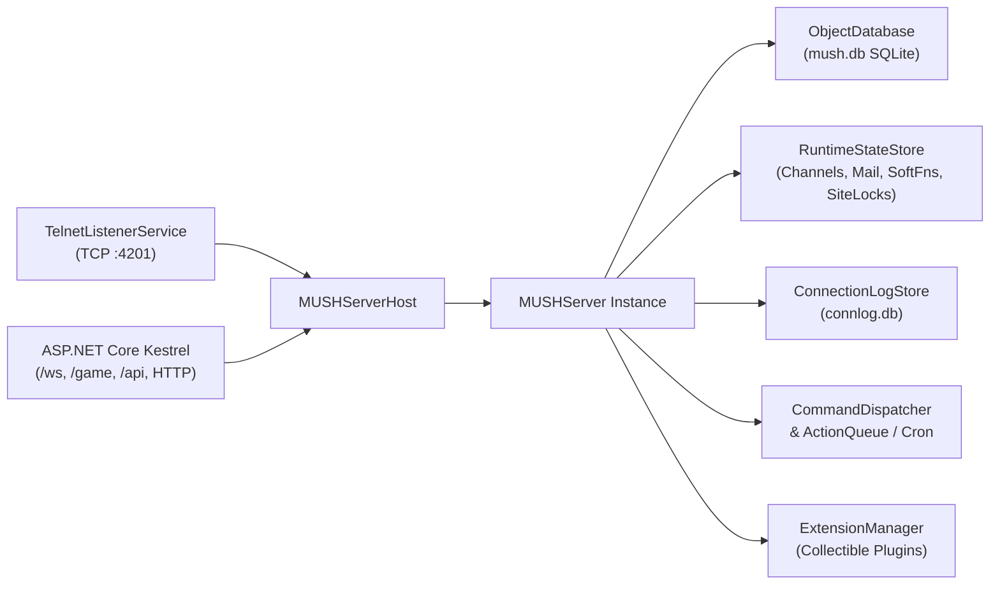

# Architecture & Concepts

This guide covers the core runtime structures implemented across `PennMUSH.Core` and `PennMUSH.Server`.

## Engine Topology

- **`MUSHServerHost`** (`PennMUSH.Server/Engine/MUSHServerHost.cs`) owns the live connection dictionary (`ConcurrentDictionary<string, MUSHConnection>`) and wraps the replaceable `MUSHServer` engine instance.
- **`MUSHServer`** (`PennMUSH.Server/Engine/MUSHServer.cs`) initializes all core subsystems (`ObjectDatabase`, `ActionQueue`, `CronScheduler`, `ChannelRegistry`, `MailStore`, `MailAliasTable`, `SiteLockTable`, `FunctionRegistry`, `ExpressionEvaluator`, `CommandDispatcher`, `HelpStore`, `TextFileCache`, `SqlDatabase`, `ConnectionLogStore`, `HttpChannel`, `ExtensionManager`) and runs the background queue/cron tick loop.

---

## Objects, Dbrefs & Objids

Every entity in `ObjectDatabase` is an instance of `MUSHObject` (`PennMUSH.Core/Entities/MUSHObject.cs`) keyed by an integer `Dbref` (`PennMUSH.Core/Types/Dbref.cs`):

- **Special Dbref Sentinels**:
  - `#-1` (`Dbref.Nothing`) — invalid / unset reference
  - `#-2` (`Dbref.Ambiguous` / `Dbref.AnyOwner`) — ambiguous match / wildcard owner
  - `#-3` (`Dbref.Home`) — dynamic home target for movement / links
- **`ObjectType` Flags** (`PennMUSH.Core/Types/ObjectType.cs`): `Room` (`0x1`), `Thing` (`0x2`), `Exit` (`0x4`), `Player` (`0x8`), `Garbage` (`0x10`), `Marked` (`0x20`).
- **Objid Format (`%:` / `objid()`)**: `#<dbref>:<unix_creation_seconds>`, pairing the object's `Dbref` with `MUSHObject.CreationTime` (`ToUnixTimeSeconds()`).
- **World Bootstrap** (`WorldBootstrapper.GenerateBaseWorld`): When starting with an empty database, the server creates:
  - `#0` — **Room Zero** (Limbo, default `player_start`, `base_room`, `default_home`)
  - `#1` — **One** (`Player`, `WIZARD` + `IsGod`, `1000` pennies, `WarningBits.Normal`)
  - `#2` — **Master Room** (default `master_room`)
  - `#3` — **System Object** (`Thing`, `SAFE` + `VISUAL` + `NO_COMMAND`, located in `#2`, `SYSTEM=#3` attribute, global `$name` object registry; configurable via `system_object`)
  - Default `Public` channel (`ChannelFlags.Public | ChannelFlags.Player`, owned by `#1`).

### Object Matching Resolution (`ObjectDatabase.MatchObject`)
When matching `<name>` relative to `<executor>` (`PennMUSH.Core/Database/ObjectDatabase.cs`):
1. `"here"` → executor's `Location`
2. `"me"` → executor
3. `"*<player>"` → global `FindPlayer` lookup
4. `"$<name>"` → global `ResolveGlobalObject` lookup (reads attribute `<NAME>` on `ObjectDatabase.SystemObjectId`, default `#3`, and parses its `#dbref`)
5. `#<n>` or plain `<n>` → direct `GetObject(new Dbref(n))`
5. Current room's contents (`FindInContents` exact, then prefix match)
6. Current room itself (exact, then prefix match)
7. Exits in current room (`FindExit`, splitting exit names on `;`)
8. Executor's inventory (`FindInContents` exact, then prefix match)
9. Executor's own name (exact, then prefix match)
10. Global player name (`FindPlayer`)
11. Global object name (`FindObject`)

---

## Multi-Parent & Multi-Zone DAG Inheritance

Unlike stock PennMUSH 1.8's single-parent chain, `MUSHObject` stores:
- **`Parents`** (`IReadOnlyList<Dbref>`): An ordered list of parent objects (`@parent <obj>=<p1> <p2>...`).
- **`Zones`** (`IReadOnlySet<Dbref>`): A set of zero or more zone objects (`@zone <obj>=<z1> <z2>...`).

**Cycle Prevention**: `MUSHObject.WouldCauseParentCycle()` rejects any parent edge that would create a cycle in the parent DAG. `ZoneOperations.WouldLoop()` performs the equivalent cycle check for `@chzone` operations.

**Attribute Lookup Order**: `MUSHObject.GetAttributeWithSource()` and `AttributePermissions.EnumerateAttributes()` check own attributes first, then perform a **breadth-first (BFS) traversal** over the parent DAG queue with a `seen` cycle-guard set, skipping inherited attributes flagged `AttributeFlags.Private`.
> Note: `@version` / `Feedback` text historically describes this subsystem as `"C3 DAG inheritance"`, whereas the runtime lookup in `MUSHObject.cs` traverses `_parents` in ordered breadth-first order.

**Tree/Branch Attributes**: Attributes containing `` ` `` (e.g., `FOO`BAR`) enforce read permission inheritance from every parent branch (`FOO`) down to children (`AttributePermissions.CanRead`).

---

## Command Dispatch Pipeline

`CommandDispatcher.Run()` (`PennMUSH.Core/Commands/CommandDispatcher.cs`) resolves commands in this order:

1. **Shortcut Prefixes** (`CommandDispatcher.Parse`): Leading `"` / `'` → `say`, `\` → `@emit`, `:` → `pose`, `;` → `;` (`semipose`). Switches are parsed after `/` into `CommandContext.Switches`, and arguments split on the first `=` into `LeftArg` / `RightArg`.
2. **Command Table Lookup** (`CommandTable.Lookup`): Matches registered command names, `alias.cnf` aliases, and unique prefixes unless reserved via `reserve_alias`.
   - Checks command enabled state and restrictions (`nobody`, `noguest`, `nofixed`, `nogagged`, `god`, `wizard`, `admin`).
   - Runs `@hook` lifecycle (`CommandCatalog.Prepare` / `After`: `ignore`, `extend`, `override`, `before`, built-in handler, `after`).
3. **Inline Attribute Assignment** (`AttributeSetCommandHandler.TryExecute`): Matches `&<attr> <obj>=<val>`, `@_<attr> <obj>=<val>`, or `@<std-attr> <obj>=<val>` (with prefix lookup via `StandardAttributes.TryResolve`).
4. **Implicit Room Exits**: Matches exits in the executor's current room and dispatches through `go`.
5. **Channel Prefix (`+<channel>`)**: `+<channel>/who ...` routes to `@channel`; `+<channel> <msg>` routes to `@chat`.
6. **`$`-Command Listeners**: Scans room, room contents, executor inventory, and self (`Dispatcher.TryMatchCommandListener`) for attributes starting with `$<pattern>:<action>`, binding regex/wildcard captures (`%0–%9`) and queuing/executing the matched action.
7. Otherwise notifies `"Huh?  (Type \"help\" for help.)"`.

---

## Queues, Semaphores & Cron

- **`ActionQueue`** (`PennMUSH.Core/Queue/ActionQueue.cs`): Thread-safe queue assigning monotonically increasing integer `Pid`s (`MaxQueueEntriesPerPlayer = 500` by default). Supports timed `@wait <secs>=<cmd>`, named `@wait <obj>/<secs>=<cmd>` semaphores (`@notify` / `@drain`), `@halt` / `@allhalt`, `@ps`, `@kick`, and `pidinfo()` / `getpids()` / `lpids()`.
- **`CronScheduler`** (`PennMUSH.Core/Scheduling/CronScheduler.cs`): Persists recurring 5-field cron jobs in SQLite (`cron_jobs` table), managed via `@cron` and inspected via `cron_list()` / `cron_info()`.

---

## Zero-Disconnect Hot-Reboot Lifecycle

Both `@reboot` (Wizard) and HTTP `POST /reboot` invoke `MUSHServerHost.Reboot()`:
1. Acquires `_rebootLock` and optionally announces hot-reboot to all connected sockets.
2. Calls `_server.PrepareForReboot()`, saving `ObjectDatabase` + `CronScheduler` (`SqliteStore`), `RuntimeStateStore`, and cleanly shutting down/unloading loaded `IExtension` plugins.
3. Instantiates a fresh `MUSHServer` (reloading DB, runtime state, config, text/help caches, SQLite connections, and plugins).
4. Re-registers every still-open TCP/WebSocket `MUSHConnection` with `isReconnect: true`, keeping all client descriptors and player logins alive with zero dropped sockets.
